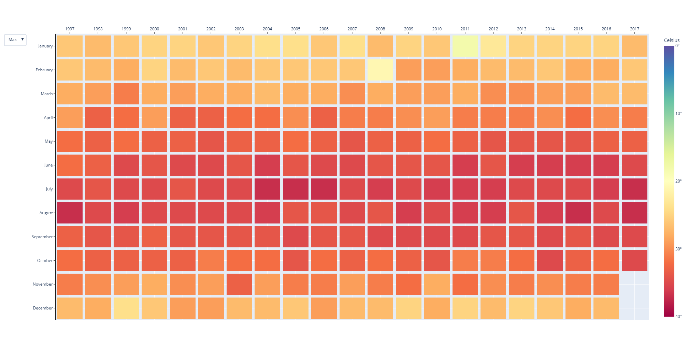
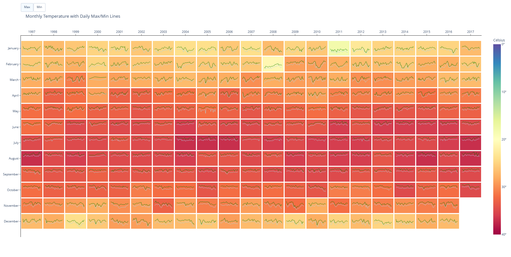

# Weather Visualization

Matrix view of monthly max/min temperatures, built with Plotly.

## How to run

```bash
pip install pandas numpy plotly
python level1.py
```

## Level 1


Each cell is one month; color shows the max or min temperature. Use the
buttons to switch between them, and hover for exact values.

## Level 2


Adds daily max (green) and min (light blue) temperature lines inside each cell.
